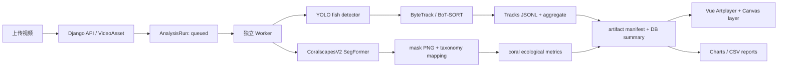

# 01 · 模块化单体 MVP 架构（提案）

> **已确认：** 鱼类轨迹/活动热图只使用视频画面归一化坐标（image_plane），不是海底地理热点。其他结构选择仍是待评审提案。参见 ADR-001。

## 原则

1. 保留 Vue + Django，**不引入第二套 Web 后端、不拆微服务、不重写已有 YOLO**。
2. **视频资产 Video(Task) 与分析执行 AnalysisRun 分离**：一段视频能重复用不同版本模型做鱼类追踪、珊瑚分割或联合分析；各次结果不可相互覆盖。
3. 把推理、渲染、统计做成可组合 **pipeline stage**，所有阶段的输入输出有格式版本；模型适配器隔离 YOLO 与 Hugging Face/Transformers。
4. GPU 消费与 Web 请求隔离：MVP 只有一个 Worker 进程消费 DB 中的队列；不会因为页面关闭丢任务。大规模时升级 PostgreSQL + Redis + Celery 或 RQ。
5. 视频可视化优先前端重叠绘制，不要求每切换一类图层都重新编码 MP4。

## 推荐数据流

## 模块/代码边界

| 模块所有权 | 现有可复用 | 新增路径建议 | 单一职责 |
| --- | --- | --- | --- |
| Video Asset / API | `views.py`, `models.py` | `backend/app/api/analysis.py`, `models_analysis.py` | 视频元数据、运行创建、查询与权限 |
| Task Worker | `services/task_runner.py` 进度回调 | `backend/app/management/commands/run_analysis_worker.py` | 获取任务、重试、原子状态转移、心跳 |
| Fish detection + MOT | `services/detector.py` 的权重解析、读帧 | `backend/app/analysis/fish.py`, `tracking.py` | 顺序跟踪并输出持久 ID 与点轨迹 |
| Coral semantic segmentation | 当前无 | `backend/app/analysis/coral.py`, `taxonomy.py` | 预训练模型推理、mask 输出、类别映射 |
| Metrics & export | 当前右侧简单 counts | `backend/app/analysis/metrics.py` | 从轨迹/掩膜计算可复现指标 |
| Artifacts | `media/uploads/results` | `backend/app/analysis/storage.py` | 对 Run 存结果、manifest、文件校验 |
| Web workspace | `App.vue`, `VideoWorkspace.vue` | `frontend/src/composables/useAnalysisRun.js` | 分析 Run、图层启停及加载 |
| Visual layers | `VideoWorkspace.vue` 的 Canvas | `frontend/src/components/overlays/` | 分开的 Boxes / Trajectories / Heatmap / Segmentation |
| Charts | `RightPanel.vue`, `RecordsView.vue` | `frontend/src/components/analysis/` | 分析摘要、时间曲线、导出 |
| Training CLI | README 手动代码片段 | `backend/ml/`（单独依赖组/可独立训练） | 视频抽帧、标注数据检查、训练、评估、模型注册 |

`backend/ml/` 不加载到每次 Django 请求；推理依赖与训练依赖分组。GPU 推理尽量复用一个模型实例，但任何不同视频的轨迹状态必须显式重置，避免跨任务串 ID。

## 数据存储建议（MVP）

- `Task` 继续代表上传视频；新增 `AnalysisRun`：`task`、`kind`、`status`、`model_version`、`config_snapshot`、`progress`、`error`、`summary`、`artifact_manifest`、时间戳。
- `ModelVersion`：模型 ID、类型、权重路径、sha256、taxonomy 版本、框架、数据集版本、训练参数概要；不存权重二进制到 DB。
- `AnnotationDatasetVersion`：标签 schema、来源视频/站点列表、split 清单/哈希、标注人员和复核状态。
- `media/analysis/<run_uuid>/` 保存轨迹分块、时间轴聚合、热力网格、关键帧 PNG 掩膜、统计 CSV/JSON；文件路径必须校验在媒体根目录内。
- 避免将完整逐帧 mask 和每一个 bbox 全塞进 SQLite JSONField；DB 保存能快速筛选的小型摘要。

## 追踪设计：一个核心工程分歧

- 后端使用 Ultralytics 内置的 `model.track(..., persist=True, tracker='bytetrack.yaml')` 的**连续帧**路径（也可在测试中对比 BoT-SORT），从 `results[0].boxes.id` 获取稳定 ID。
- 按轨迹 ID 保存各时间点的中心/底边中点/检测框；画面层的热力图选择**轨迹中心按时长采样聚合**，而非直接将检测框次数累加。
- `frame_stride=1` 为第一版追踪默认；在显卡不足时调采样率，记录 `sampling_fps`。低置信度/断轨、ID switch 不做静默合并。
- 静止相机可把二维归一化轨迹视为同一图像平面；**移动相机默认禁止「海底空间热点」语义**，仅展示画面相对热点。要得到地理生态热区需稳定化/正射拼接/SLAM/位姿与尺度信息。
- 珊瑚属于静态底栖结构，MVP **不按鱼类 ByteTrack 给珊瑚计数**，使用按帧语义 mask 与固定样方指标。

## 前端 MVP 页面

1. **分析任务**：视频列表、分析类型 `fish_tracking` / `coral_health` / `joint`、模型版本与参数、排队/运行/失败/重试。
2. **视频工作台**：原视频/渲染视频切换，图层选择（检测框、ID、尾迹、全程轨迹、二维热力图、珊瑚健康半透明 mask）；时间轴同步；轨迹可选中高亮。
3. **统计面板**：fish track count（明确不是鱼口数量）、轨迹长度 px、轨迹密度、珊瑚可见像素占比、白化占比、类别趋势与置信度。
4. **数据管理/训练**：MVP 仅提供数据集版本登记与触发本地 CLI 的结果导入；浏览器直接 GPU 训练与细粒度协作标注放 P1/P2。标注优先复用 CVAT，不新造编辑器。

## 部署

- 继续 docker-compose: `frontend`, `backend`, `worker`，worker 与 backend **同代码镜像不同启动命令**，共享数据库和 media 卷。
- DB/queue MVP 只有一个 worker 且 SQLite；提供超时与失败恢复语义（例如重启将超时 running Run 标记为 retryable，人工或有限次数重新入队）；运行期独占 lease/heartbeat。
- 通过 API 对外提供文件访问，校验路径与权限；不要向浏览器暴露任意服务器模型路径。

## 明确不做（本期）

分布式训练、微服务架构、实时 RTSP 多路流、在线标注系统、珊瑚种属完整鉴定、无人监督全自动生态结论、海底 GIS 热力图，以及复杂用户权限系统；不过公开外网前最小认证和文件防护属于必须完成的安全工作。

## 调研驱动的子模块

- 开源项目复用/许可证：[06-open-source-adoption.md](06-open-source-adoption.md)。
- 珊瑚 95 类 SegFormer 与 96 logits（0=void）标签契约、zero-shot、专家复核、站点级 split、训练/消融：[07-coral-training-blueprint.md](07-coral-training-blueprint.md)。
- 鱼活动热图按 track-seconds 统计，raw grid 与 display grid 分开，随时间窗可复算：[08-video-heatmap-and-datamining.md](08-video-heatmap-and-datamining.md)。
- 详细并行开发任务和契约交付：[10-work-packages-and-integration.md](10-work-packages-and-integration.md)；官方出处：[11-sources.md](11-sources.md)。

## MVP v2：科研可信训练报告 + 可选 VLM 预标注 + 3 页面信息大屏

新增**离线训练评测子系统**（独立于视频推理）：
Video/Frames → Expert GT/DatasetVersion → TrainingRun → frozen test EvaluationRun（真实评测值） → TrainingReport（可选 AI 自然语言报告） → ModelVersion 审批 → Vue3 WallDashboard。所有量化指标由 deterministic evaluator/现成评测库完成，语言模型只写诊断；fish detection、MOT、coral segmentation 分别报告，不把单个 YOLO mAP 代替生态任务成功。

自动标注参考 VLM-AutoYOLO，采用独立可替换 DataIngest/AnnotationProvenance 接口，MVP 先导入经人工复核的 YOLO/COCO 文件。AGPL 项目源码、NVIDIA 非商业权重、GPU 高占用和 SAM3 gate 必须单独审核；**不要将完整 React/FastAPI app 合并进 Django/Vue**。

前端保留原 VideoWorkspace 为交互工作台，增加 /wall（生态总览）、/wall/train（训练效果量化）、/wall/evidence（生态证据）三个信息大屏视图。大屏的主视觉仍是 Artplayer+Canvas 视频/轨迹/mask，ECharts 负责图表，DataV-Vue3 仅按需用于装饰，绝不创建第二套视频坐标系统。仅用户需求层面“大屏目标”已确定，依赖/设计方案仍待评审。

详见 [12-training-report-and-benchmark.md](12-training-report-and-benchmark.md)、[13-vlm-autoyolo-integration.md](13-vlm-autoyolo-integration.md)、[14-visual-wall-research-and-spec.md](14-visual-wall-research-and-spec.md)、[15-mvp-v2-milestones.md](15-mvp-v2-milestones.md)。
